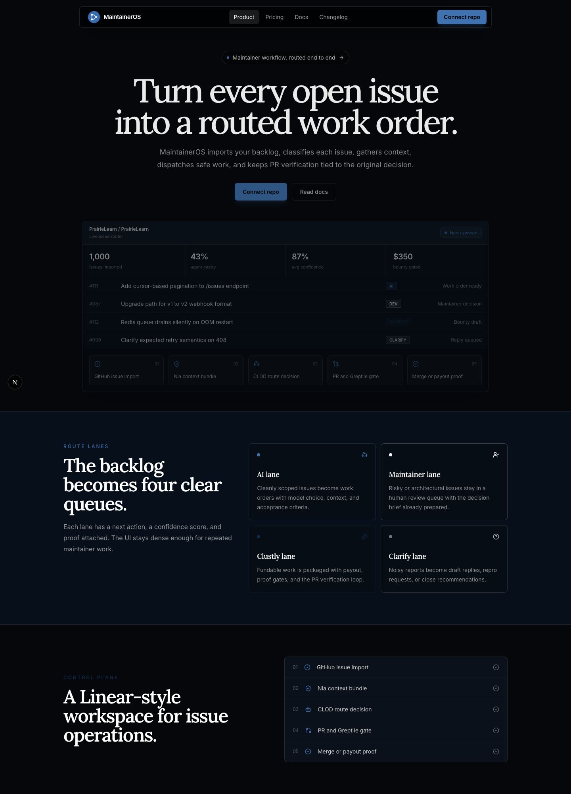
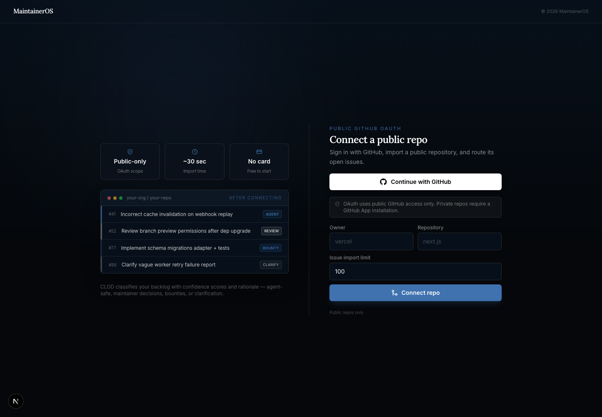
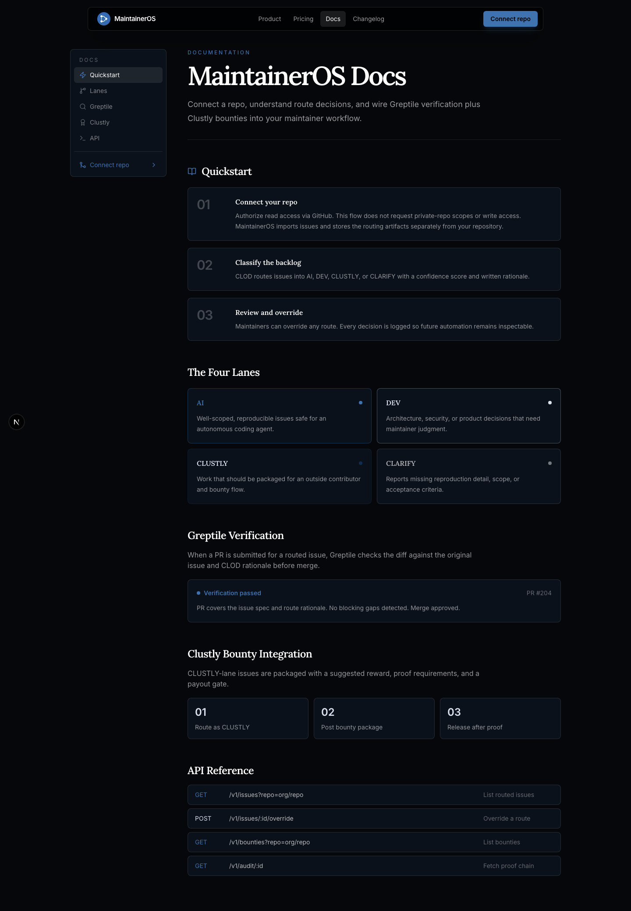

# MaintainerOSS

Repo-native work routing for maintainers who want agent fixes, contributor bounties, and PR verification to stay tied to reviewable proof.

MaintainerOSS is the open-source workspace for MaintainerOS. It imports GitHub issue backlogs, classifies work into operating lanes, prepares context for safe automation, keeps risky work in maintainer review, and gates bounty payouts on fresh PR verification.

## Sponsor & Provider Stack

[](https://github.com)
[](https://neon.com)
[](#)
[](#)
[](https://www.daytona.io)
[](https://www.greptile.com)
[](#)
[](https://stripe.com)



## Product Surfaces

### Product Landing

The landing page explains the end-to-end issue workflow: GitHub import, context gathering, CLōD route decisions, PR and Greptile gates, and merge or payout proof.

### Connect Repo

Maintainers can connect a public GitHub repository, import open issues, and route the backlog into MaintainerOS without requiring private-repo scopes.



### Docs

The docs page describes the operating model for GitHub import, routing lanes, Greptile verification, and Clustly bounty packaging.



## Routing Model

MaintainerOS turns issue backlogs into four clear operating lanes:

- **AI**: scoped issues that can become agent work orders.
- **DEV**: risky or architectural issues that need maintainer judgment.
- **CLUSTLY**: bounty-ready issues with funding and payout proof requirements.
- **CLARIFY**: incomplete issues that need a reply, repro request, or close recommendation.

## Trust Boundary

MaintainerOS treats automation as a proposal, not a result. Agent work, contributor submissions, and bounty releases all stay behind explicit verification gates:

```text
issue -> route -> context -> attempt or task -> PR -> verification -> maintainer acceptance -> merge or payout
```

Recent `main` work tightened that boundary by adding async Greptile verification evidence, applying agent text edits directly, hardening patch execution, recounting generated patches, and including repository file context in agent patch requests.

## Project Layout

```text
app/                    Next.js routes and API handlers
components/blocks/      Product, docs, changelog, and repository surfaces
components/maintaineros/ MaintainerOS workflow panels and controls
data/mock-repos/        Fixture issue backlogs for local demo mode
infra/neon/             Neon schema and import support
lib/maintaineros/       Routing, provider adapters, verification, payout logic
public/screenshots/     README screenshots captured from the local app
scripts/                Smoke tests, fixture generation, provider prep
```

## Local Setup

Use Node.js `>=20.9.0`.

```bash
npm install
cp .env.example .env.local
npm run dev
```

Open [http://localhost:3000](http://localhost:3000). If that port is busy, Next.js will print the alternate local URL.

## Data Modes

Fixture mode is the default path for local work and demos:

```bash
MAINTAINEROS_OFFLINE_MODE=true
MAINTAINEROS_DATA_MODE=fixture
```

Live imports use Neon/Postgres plus GitHub settings from `.env.example`:

```bash
MAINTAINEROS_OFFLINE_MODE=false
MAINTAINEROS_DATA_MODE=live
NEON_DATABASE_URL=...
GITHUB_TOKEN=...
```

GitHub imports default to the first 5,000 open issues so large public repositories can populate the live dashboard without manual limit changes. The import path also captures open pull requests and Greptile comments so verification queues can show live review evidence.

## Commands

```bash
npm run dev
npm run lint
npm run typecheck
npm run build
npm run ci
```

Provider and demo prep:

```bash
npm run fixtures:generate
npm run github:seed-demo
npm run neon:smoke-import
npm run prep:check
npm run backend:check
```

## Deployment Check

Before deploying or landing changes, run the narrowest useful checks for the touched surface. For README-only changes, verify Markdown assets exist and run:

```bash
npm run lint
npm run build
```

For application or provider changes, use:

```bash
npm run ci
```
