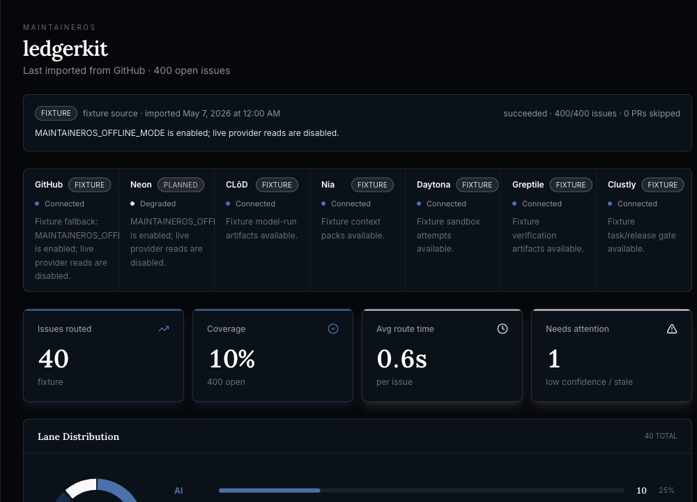

<div align="center">
  

  # MaintainerOSS

  **Repo-native work routing for the agent era.**

  MaintainerOSS is the open-source workspace for MaintainerOS: a maintainer control plane that turns issue backlogs into routed work orders, isolated agent attempts, human review queues, and proof-gated Clustly bounty packages.
</div>


## What It Does

Open-source maintainers do not just have a backlog problem. They have a trust problem: generated fixes are cheap, but reviewing hidden risk is expensive.

MaintainerOS asks a simpler question: **what if the backlog could route itself into the right kind of work?**

It imports GitHub-hosted issues, normalizes repository context, and routes every issue into a clear operating lane:

| Lane | Purpose |
| --- | --- |
| **AI / Agent-safe** | Clear, low-risk issues become isolated agent work orders with context, acceptance criteria, and verification gates. |
| **DEV / Maintainer review** | Risky work, architectural decisions, security concerns, or low-confidence routes stay with maintainers. |
| **CLUSTLY / Bounty-worthy** | Valuable work becomes a paid contributor task with funding, claim, submission, and payout proof. |
| **CLARIFY / Close** | Vague, stale, incomplete, or blocked issues become draft replies, repro requests, or close recommendations. |

The dashboard keeps the routing decision, provider health, PR verification, payout gate, and trace ledger tied to the original issue.



## Trust Model

MaintainerOS does not trust automation just because it opened a pull request. Every workflow keeps an evidence trail:

```text
issue import -> route decision -> context pack -> sandbox attempt -> PR -> verification -> maintainer acceptance -> payout eligibility
```

Routing starts with CLōD model judgment, then deterministic policy gates enforce the safety boundary. Hard-block labels such as `security` or `decision-needed` force maintainer review. Low confidence blocks automation. Missing requirements route to clarify-or-close. Only issues that pass policy become agent-safe.

For PR trust:

```text
trustedPR = linkedPR + passedVerification + currentHeadSHA
```

For bounty release:

```text
release = bounty + funded + linkedPR + freshVerification + maintainerAcceptance
```

If anything is missing, MaintainerOS blocks the next step and explains why. Stale verification, failed checks, missing PR links, and incomplete payout gates stay visible instead of hiding behind vague status labels.

## Agent Execution

Agent-safe does not mean unchecked. MaintainerOS models each automated attempt as a Daytona-style sandbox record with:

- command plan and commands run
- files touched and logs captured
- baseline or enriched context mode
- exit status, failure reason, and duration
- branch and PR handoff

Failed attempts are preserved for review. Depending on the failure reason, the issue can escalate to a deeper retry, maintainer review, or bounty routing.

## Demo Principle

The live demo should start from real GitHub-hosted issue backlogs. Neon is the import and cache layer. Fixture/offline mode remains the fallback path so the product can be developed, demoed, and tested without provider credentials.

## Tech Stack

- **App:** Next.js 16, React 19, TypeScript
- **UI:** Tailwind CSS, Framer Motion, lucide-react
- **Data:** Fixture repositories by default, Neon/Postgres for live imports
- **Providers:** GitHub, CLōD, Nia, Daytona, Greptile, Clustly, Stripe
- **Core logic:** deterministic routing policy, PR freshness checks, payout readiness gates, trace ledger artifacts

## Quick Start

Use Node.js `>=20.9.0`.

```bash
npm install
cp .env.example .env.local
npm run dev
```

Open [http://localhost:3000](http://localhost:3000).

The fixture dashboard is available at:

```text
http://localhost:3000/maintaineros/ledgerkit
```

## Useful Commands

```bash
npm run dev
npm run build
npm run lint
npm run typecheck
npm run ci
```

Demo and provider prep:

```bash
npm run fixtures:generate
npm run github:seed-demo
npm run neon:smoke-import
npm run prep:check
npm run backend:check
```

## Data Modes

Fixture mode is the default local path:

```bash
MAINTAINEROS_OFFLINE_MODE=true
MAINTAINEROS_DATA_MODE=fixture
```

Live mode uses Neon/Postgres and GitHub import settings from `.env.example`:

```bash
MAINTAINEROS_OFFLINE_MODE=false
MAINTAINEROS_DATA_MODE=live
NEON_DATABASE_URL=...
GITHUB_TOKEN=...
```

Provider credentials are optional until you need their live workflow surfaces. Without them, MaintainerOS reports fixture or degraded provider status in the UI.

## Project Map

```text
app/                    Next.js routes and API handlers
components/blocks/      Main product and dashboard surfaces
components/maintaineros/ Workflow-specific panels and controls
components/ui/          Reusable visual primitives
data/mock-repos/        Generated fixture backlogs
infra/neon/             Neon schema and import support
lib/maintaineros/       Domain model, provider adapters, routing, gates
scripts/                Smoke tests, fixture generation, provider prep
```

## Verification Model

MaintainerOS PRs are expected to pass repository verification checks before landing in `main`. Maintainer-authored branch refreshes keep preview checks tied to the repository owner when external contribution branches need to be revalidated.

Verification is treated as a trust boundary. If a PR changes after verification, the old result becomes stale and no longer unlocks completion, merge readiness, or payout release.

For a broad local confidence check, run:

```bash
npm run ci
```

## What's Next

- Deeper live Daytona sandbox execution
- Live Clustly funding, claim, submission, and release flows
- Stronger GitHub workflow automation
- Repository-specific routing and approval policies
- Expanded evaluation coverage for routing, verification, and payout gates
