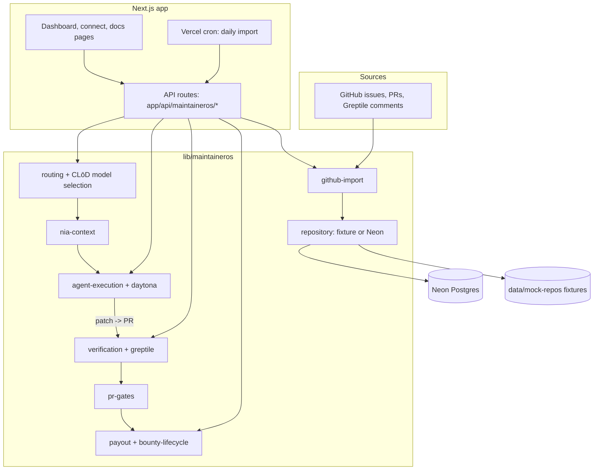

# Architecture

MaintainerOSS is a single Next.js app. The UI and the API routes live in `app/`, and all domain logic lives in plain TypeScript modules under `lib/maintaineros/`. The rule behind the design is that **automation produces proposals, never results**. Every agent patch, contributor PR and bounty payout has to pass explicit, deterministic gates before a maintainer can accept it.

## System overview



## Issue lifecycle

```text
import -> score -> route -> context -> attempt or task -> PR -> verification -> gates -> maintainer acceptance -> merge or payout
```

1. **Import** (`github-import.ts`). Pulls up to 5,000 open issues, plus open PRs and Greptile review comments, from a public repo. It runs on demand through `/api/maintaineros/import-github` and daily through the Vercel cron in `vercel.json`.
2. **Score and route** (`routing.ts`). `scoreIssue` derives complexity, risk and confidence from labels and heuristics, then picks one of four routes:
   - `agent-solvable` (AI): only when `evaluateRoutePolicy` finds no risk, complexity, confidence or label blockers.
   - `maintainer-review` (DEV): human-owned. Autonomous execution never starts.
   - `bounty-worthy` (CLUSTLY): bounded paid work for contributors.
   - `close-or-clarify` (CLARIFY): needs a repro or expected behaviour first.

   Two or more prior failed attempts push an AI issue to DEV or CLUSTLY. `selectClodModel` picks the cheapest CLōD model tier that fits the decision.
3. **Context** (`nia-context.ts`). Builds a Nia context pack for the issue, or a deterministic fixture pack when offline.
4. **Attempt** (`agent-execution.ts`, `daytona.ts`, `agent-patch-package.ts`). Generates a patch package through CLōD and runs it in a Daytona sandbox. Sandbox output counts as evidence, not proof of correctness.
5. **Verify** (`verification.ts`, `greptile.ts`). Greptile reviews the PR. A verification is **stale** as soon as the PR head SHA moves past the verified SHA.
6. **Gate** (`pr-gates.ts`). `evaluateSafeSquashMerge` blocks a merge unless the PR is automation-owned, open and not a draft, has fresh passing verification and passing required checks, is current with base, has no human commits, and branch protection allows squash merges. `planFailedPrReroute` closes failed automation PRs and reroutes the issue, and it never touches human PRs.
7. **Pay out** (`payout.ts`, `bounty-lifecycle.ts`, `payments.ts`). `canReleasePayout` releases a Clustly bounty only when the issue is on the bounty route, the bounty is funded, a PR is linked, verification is fresh and passing, and the maintainer has accepted the work.

Every step writes trace events (`trace-events.ts`, `route-history.ts`), so failed attempts and reroute reasons stay visible.

## Data modes

`repository.ts` chooses the storage backend at request time:

| Mode | When | Backend |
| --- | --- | --- |
| Fixture | Default. Used unless `MAINTAINEROS_OFFLINE_MODE=false`, and also when live mode has no database URL | `FixtureMaintainerOSRepository` reading `data/mock-repos/` |
| Live | `MAINTAINEROS_OFFLINE_MODE=false`, `MAINTAINEROS_DATA_MODE=live`, and `DATABASE_URL` (or `NEON_DATABASE_URL`) set | `NeonMaintainerOSRepository` over the schema in `infra/neon/` |

The Neon schema (`infra/neon/001_init.sql`) holds `repositories`, `issues`, `issue_classifications`, `work_orders`, `pull_requests`, `verification_runs`, `bounties`, `payment_artifacts` and `model_runs`. Optional auth and row-level security are in `002_optional_auth_rls.sql`.

Fixture data keeps the dashboard runnable offline, but a missing provider key does not always produce a fixture result. Without its key, CLōD returns a fallback routing artifact, Nia can return a fixture context pack, and Greptile returns a blocked verification. Daytona sandbox creation and `LiveClustlyProvider.createTask()` throw an error, and Stripe billing stays disabled unless `BILLING_ENABLED` and its keys are set. The test suites use fixture inputs and injected responses, so they don't depend on any provider.

## Testing strategy

The trust boundary is pure logic, so it is tested without network access. `npm test` runs these TypeScript suites in `scripts/`:

| Suite | Covers |
| --- | --- |
| `routing-policy-smoke.ts` | Lane routing, policy gates, retry rerouting |
| `issue-workflow-projection-smoke.ts` | Issue to work-order projection |
| `agent-execution-smoke.ts` | Patch generation and execution |
| `ai-execution-artifacts-smoke.ts` | Attempt evidence and artifacts |
| `greptile-v2-smoke.ts` | Greptile verification parsing |
| `verification-payout-smoke.ts` | Stale-SHA detection, merge gates, payout gates |
| `connect-oauth-smoke.mjs` | GitHub OAuth connect flow |

CI (`.github/workflows/ci.yml`) runs lint, typecheck, these tests, the prep and backend-policy checks, and a production build on every PR.
